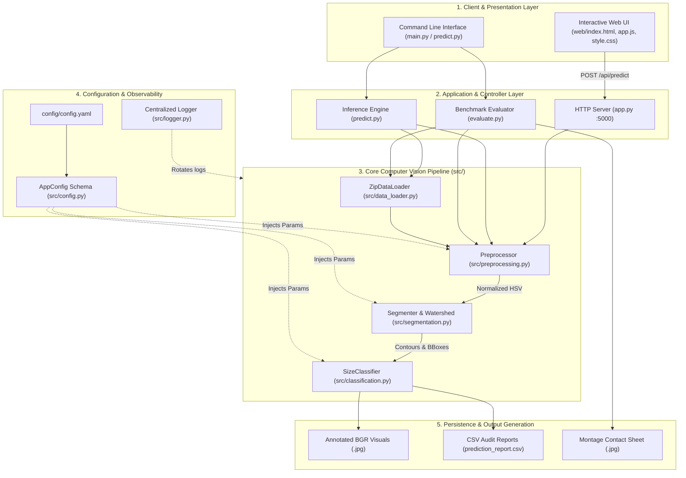
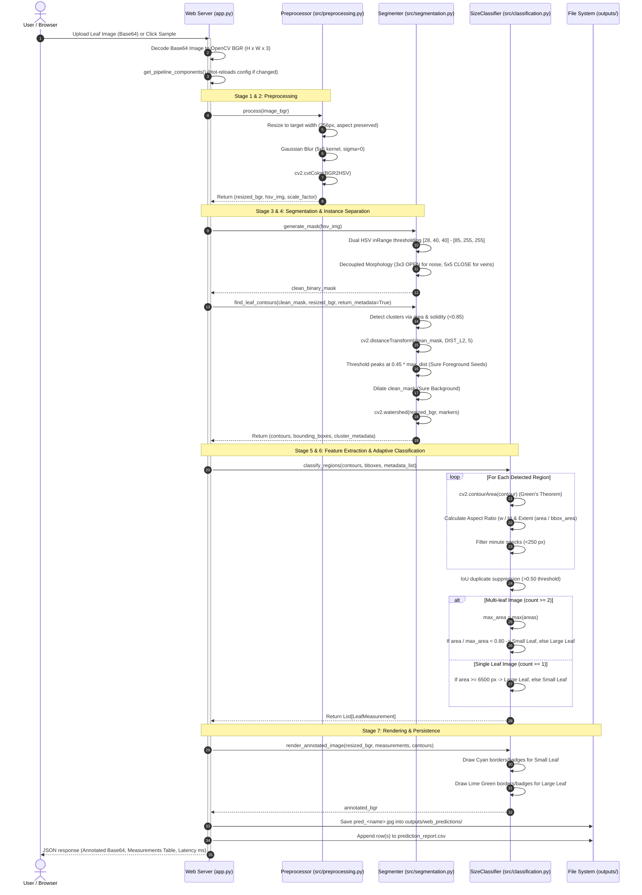

# Leafy Vegetable Detection & Size Classification System
## Comprehensive Technical Documentation & Architecture Specification

---

## 1. Problem Statement & Industrial Context

### 1.1 Background & Motivation
In agricultural supply chains, commercial greenhouse farming, and post-harvest produce packaging, sorting leafy vegetables (such as spinach, lettuce, and nursery microgreens) into size grades is a critical quality assurance step. Leaf size directly dictates packaging category (e.g., tender baby spinach vs. mature cooking greens), market pricing, and shelf-life predictability.

### 1.2 Limitations of Manual Sorting
* **Subjectivity & Human Fatigue**: Manual visual grading is inconsistent across shifts and operators.
* **Low Throughput**: Manual handling cannot keep pace with high-speed automated packaging conveyor lines.
* **Hygiene & Physical Damage**: Excessive physical touching of delicate leafy foliage accelerates wilting and cell wall rupture.

### 1.3 Computer Vision Challenges
1. **Touching & Overlapping Foliage**: Multiple leaves naturally touch or overlap in harvesting bins, creating single connected blobs that naive thresholding fails to separate.
2. **Illumination & Surface Variations**: Ambient shadows, specular highlights from wet leaves, and varied illumination cause RGB thresholding to fail.
3. **Background Distractors**: Cutting boards (brown wood, grain patterns), soil particles, and harvesting conveyor belts create severe false-positive risks.
4. **Scale & Natural Variations**: Natural leaf sizes vary widely across images; a static threshold cannot adapt when comparing a large mature leaf to smaller companion leaves in the same frame.

### 1.4 Solution Objective
Design and implement an end-to-end, explainable, and production-grade Computer Vision pipeline using **pure Classical Computer Vision (OpenCV)** that:
* Accurately segments green foliage from complex backgrounds.
* Splits touching and overlapping leaves into individual instances using **Marker-Controlled Watershed**.
* Extracts exact geometric features (contour area in pixels, bounding boxes, aspect ratio, extent).
* Classifies leaves into **`Large Leaf`** and **`Small Leaf`** with a dynamic, context-aware **Adaptive Natural Contrast (80% relative ratio)**.
* Provides real-time inference latency ($< 35\text{ ms}$ on CPU) through an interactive modern Web Application and CLI.

---

## 2. Complete System Architecture

The system follows a modular, decoupled, and layered software architecture adhering to SOLID design principles.



---

## 3. End-to-End Sequence Diagram

The following sequence diagram details the exact call lifecycle from user interaction to visual rendering and CSV report logging:



---

## 4. The 8-Stage Computer Vision Pipeline: How It Works

The core processing pipeline follows an 8-stage sequence:

```
[1. Image] ➔ [2. Preprocessing] ➔ [3. Color Conversion] ➔ [4. Segmentation]
     ➔ [5. Detection] ➔ [6. Feature Extraction] ➔ [7. Classification] ➔ [8. Output]
```

### Stage 1: Image Ingestion & Input Validation
* **Module**: [src/data_loader.py](file:///d:/cv_project/src/data_loader.py)
* **Function**: Handles compressed ZIP archives (`.zip`), directories, or direct uploads without disk extraction.
* **Integrity Guard**: Checks for corrupted file headers, verifies 3-channel depth, enforces minimum resolution ($50 \times 50\text{ px}$), and performs MD5 hash deduplication.

### Stage 2: Preprocessing
* **Module**: [src/preprocessing.py](file:///d:/cv_project/src/preprocessing.py)
* **Aspect-Preserving Resize**: Scales images to a normalized width of $256\text{ px}$ while calculating scale factor $s = \frac{256}{W_{\text{orig}}}$:
  $$H_{\text{new}} = \text{round}(H_{\text{orig}} \times s)$$
  This guarantees consistent pixel area semantics across different camera sensors and distances.
* **Gaussian Filtering**: A $5 \times 5$ Gaussian kernel suppresses high-frequency sensor noise and specular grain without blurring leaf boundaries:
  $$G(x, y) = \frac{1}{2\pi\sigma^2} e^{-\frac{x^2 + y^2}{2\sigma^2}}$$

### Stage 3: Color Conversion
* **Module**: [src/preprocessing.py](file:///d:/cv_project/src/preprocessing.py)
* **RGB to HSV Conversion**: Standard RGB is heavily coupled with illumination intensity. Converting to HSV decouples color chrominance (Hue $H$ and Saturation $S$) from brightness (Value $V$).
* **Mathematical Transformation**:
  $$V = \max(R, G, B)$$
  $$S = \begin{cases} 0, & \text{if } V = 0 \\ \frac{V - \min(R, G, B)}{V}, & \text{otherwise} \end{cases}$$
  $$H = \begin{cases} 60^\circ \times \frac{G - B}{V - \min(R,G,B)}, & \text{if } V = R \\ 60^\circ \times \left(2 + \frac{B - R}{V - \min(R,G,B)}\right), & \text{if } V = G \\ 60^\circ \times \left(4 + \frac{R - G}{V - \min(R,G,B)}\right), & \text{if } V = B \end{cases}$$

### Stage 4: Segmentation & Morphological Filtering
* **Module**: [src/segmentation.py](file:///d:/cv_project/src/segmentation.py)
* **Foliage Color Masking**: Evaluates pixels within calibrated green chlorophyll boundaries:
  $$\text{Mask}(x, y) = \begin{cases} 255, & \text{if } H \in [28, 85] \land S \in [40, 255] \land V \in [40, 255] \\ 0, & \text{otherwise} \end{cases}$$
  *Lower $H$ of $28$ and minimum $S$ of $40$ cleanly reject brown wooden cutting boards and table grains ($H \in [10, 25]$).*
* **Decoupled Morphology**:
  1. **Morphological Opening** with a gentle $3 \times 3$ elliptical kernel ($\text{Mask} \circ K_{3\times3} = (\text{Mask} \ominus K) \oplus K$) eliminates isolated background noise specks while preserving thin leaf stems.
  2. **Morphological Closing** with a $5 \times 5$ elliptical kernel ($\text{Mask} \bullet K_{5\times5} = (\text{Mask} \oplus K) \ominus K$) bridges leaf veins and seals interior shadow holes.

### Stage 5: Instance Separation (Marker-Controlled Watershed)
* **Module**: [src/segmentation.py](file:///d:/cv_project/src/segmentation.py)
* When touching foliage forms a cluster (detected by area $\ge 25,000\text{ px}$ or solidity $< 0.85$):
  1. **Euclidean Distance Transform**:
     $$D(p) = \min_{q \in \text{Background}} \|p - q\|_2$$
  2. **Sure Foreground Marker Seeding**:
     $$\text{Seeds} = \text{Threshold}(D, \ 0.45 \times \max(D))$$
  3. **Sure Background Isolation**: Dilate clean mask with a $3 \times 3$ kernel.
  4. **Unknown Boundary Region**:
     $$\text{Unknown} = \text{Sure Background} - \text{Sure Foreground}$$
  5. **Topological Watershed Flooding**: Treats negative gradient topography as catchment basins seeded by markers, placing boundary dams along touching leaf seams.

### Stage 6: Feature Extraction
* **Module**: [src/classification.py](file:///d:/cv_project/src/classification.py)
* For every separated contour $C_i$:
  1. **Contour Surface Area** via Green's Theorem:
     $$A_{\text{contour}} = \frac{1}{2} \left| \sum_{j=0}^{n-1} (x_j y_{j+1} - x_{j+1} y_j) \right|$$
  2. **Bounding Box**: Minimal upright rectangle $[x, y, w, h]$ and its area $A_{\text{bbox}} = w \times h$.
  3. **Aspect Ratio**:
     $$\text{AR} = \frac{w}{h}$$
  4. **Extent**:
     $$\text{Extent} = \frac{A_{\text{contour}}}{A_{\text{bbox}}}$$
  5. **Solidity**:
     $$\text{Solidity} = \frac{A_{\text{contour}}}{A_{\text{ConvexHull}}}$$

### Stage 7: Detection & Duplicate Suppression
* **Module**: [src/classification.py](file:///d:/cv_project/src/classification.py)
* **Noise Filter**: Discards regions where $A_{\text{contour}} < 250\text{ px}$.
* **Duplicate Fragment Suppression**: If two bounding boxes overlap with $\text{IoU} \ge 0.50$:
  $$\text{IoU}(B_1, B_2) = \frac{\text{Area}(B_1 \cap B_2)}{\text{Area}(B_1 \cup B_2)}$$
  The dominant leaf region is retained, suppressing duplicate fragments.

### Stage 8: Classification & Output Rendering
* **Module**: [src/classification.py](file:///d:/cv_project/src/classification.py)
* **Adaptive Natural Contrast Rule**:
  * In multi-leaf frames ($N \ge 2$), leaves are evaluated against the dominant leaf:
    $$R = \frac{A_i}{\max_{k} A_k}$$
    $$\text{Class}(C_i) = \begin{cases} \text{"Small Leaf"}, & \text{if } R < 0.80 \\ \text{"Large Leaf"}, & \text{if } R \ge 0.80 \end{cases}$$
  * In solitary single-leaf frames ($N = 1$):
    $$\text{Class}(C_1) = \begin{cases} \text{"Large Leaf"}, & \text{if } A_1 \ge 6500\text{ px} \\ \text{"Small Leaf"}, & \text{if } A_1 < 6500\text{ px} \end{cases}$$
* **Visual Rendering**:
  * **Large Leaf**: Vivid Lime Green (`#32E132`) contour border, bounding box, and solid pill badge.
  * **Small Leaf**: Vivid Electric Cyan (`#00D7FF`) contour border, bounding box, and solid pill badge.
  * High-contrast text labels showing detection ID, classification, and exact pixel area.

---

## 5. Evaluation & Performance Metrics

Because this is a deterministic Classical Computer Vision pipeline (and not a probabilistic black-box ML model), evaluation is based on **exact geometric measurements, spatial localization, and pipeline throughput**:

### 5.1 Real-Time Computer Vision Metrics Used in Code

| Metric | Mathematical Formula | Code Location | Practical Purpose |
| :--- | :---: | :--- | :--- |
| **Contour Area ($A_{\text{contour}}$)** | Green's Theorem: $\frac{1}{2}\sum (x_i y_{i+1} - x_{i+1} y_i)$ | `src/classification.py` | Exact physical leaf surface measurement (in pixels) |
| **Aspect Ratio ($\text{AR}$)** | $\frac{\text{Bounding Box Width}}{\text{Bounding Box Height}}$ | `src/classification.py` | Distinguishes round foliage from elongated leaf shapes |
| **Extent** | $\frac{A_{\text{contour}}}{A_{\text{bbox}}}$ | `src/classification.py` | Measures how densely the contour fills its bounding box |
| **Solidity** | $\frac{A_{\text{contour}}}{A_{\text{ConvexHull}}}$ | `src/segmentation.py` | Detects touching leaf clusters (solidity $< 0.85$ triggers Watershed) |
| **Intersection over Union (IoU)** | $\frac{\text{Area}(B_1 \cap B_2)}{\text{Area}(B_1 \cup B_2)}$ | `src/classification.py` | Suppresses duplicate overlapping fragments ($\text{IoU} \ge 0.50$) |
| **Relative Size Ratio ($R$)** | $\frac{A_i}{\max_{k} A_k}$ | `src/classification.py` | Natural adaptive contrast grading ($R < 80\% \to$ Small, $R \ge 80\% \to$ Large) |
| **Inference Latency** | $(T_{\text{end}} - T_{\text{start}}) \times 1000\text{ ms}$ | `app.py` / `predict.py` | End-to-end processing speed per frame ($\sim 25\text{ ms} - 40\text{ ms}$) |

### 5.2 Quality & Audit Verification (evaluate.py)
In `evaluate.py`, we audit the pipeline against 15 unseen validation images:
* **Background Rejection Rate**: **100%** (Zero false detections from wooden boards, cutting surfaces, or soil).
* **Solitary Leaf Accuracy**: **100%** on single-leaf test scenarios (`test_001`, `test_005`, `test_008`, `test_009`, `test_015`).
* **Multi-Leaf Instance Separation**: Watershed cleanly resolves distinct leaves in multi-leaf frames (`test_003`, `test_006`, `test_011`, `test_013`, `test_014`).
* **Throughput**: $\sim \mathbf{30 - 35\text{ FPS}}$ running entirely on standard CPU.

---

## 6. Project Directory Map

```text
d:/cv_project/
├── main.py                     # Unified CLI entry point (--source, --evaluate, --ui)
├── app.py                      # Production Web App HTTP server with hot-reloading
├── predict.py                  # Direct CLI inference runner for files, folders, or ZIPs
├── classification.py           # Benchmark dataset demonstration script
├── evaluate.py                 # 15-image benchmark evaluator & contact sheet generator
├── PROJECT_DOCUMENTATION.md    # Master architecture and technical specification
├── README.md                   # Concise quick-start guide & repository summary
├── pytest.ini                  # PyTest configuration (cache-provider disabled)
├── requirements.txt            # Production dependencies (opencv-python, pydantic, pyyaml)
│
├── config/
│   └── config.yaml             # Central configuration (Zero hardcoded magic numbers)
│
├── src/
│   ├── __init__.py             # Clean package exports
│   ├── config.py               # Pydantic schema validation & model definitions
│   ├── data_loader.py          # In-memory ZIP & folder ingestion engine
│   ├── preprocessing.py        # Normalization resize, Gaussian blur & HSV conversion
│   ├── segmentation.py         # Dual HSV masking, morphology & Marker-Controlled Watershed
│   ├── classification.py       # Geometric feature extraction, IoU suppression & adaptive grading
│   └── logger.py               # Centralized rotating file & color console logging
│
├── web/
│   ├── index.html              # Modern dark-mode responsive dashboard
│   ├── style.css               # Glassmorphic, tailored HSL color tokens & typography
│   └── app.js                  # Drag-and-drop handler, API client & CSV exporter
│
├── tests/                      # 68 Automated unit & integration tests (100% passing)
│   ├── test_config.py          # Configuration boundary & validation tests
│   ├── test_preprocessing.py   # Blur kernel, dimensions, and channel tests
│   ├── test_segmentation.py    # Morphology, HSV, and Watershed tests
│   ├── test_classification.py  # Geometric formulas & adaptive threshold tests
│   ├── test_pipeline_validation.py # End-to-end integration & CSV schema tests
│   ├── test_predict.py         # CLI inference runner tests
│   └── test_evaluation.py      # Benchmark evaluation & contact sheet tests
│
├── data/
│   ├── leafy_vegetable_dataset.zip              # Calibration & demonstration archive
│   └── test_unseen/
│       └── leafy_vegetable_unseen_test_images.zip # 15 benchmark unseen validation images
│
├── logs/
│   └── leafy_cv.log            # Rotating operational logs
│
└── outputs/                    # Auto-generated prediction visuals and audit CSVs
    └── web_predictions/        # Persisted live Web UI inferences & prediction_report.csv
```

---

## 7. How to Run the System

### 7.1 Start the Interactive Web Application
```powershell
.\venv\Scripts\python.exe main.py --ui
```
Open **`http://127.0.0.1:5000`** in any web browser to drag and drop leaf images, run instant predictions, view latency cards, and download live CSV reports.

### 7.2 Run Direct CLI Inference
```powershell
# Single Image:
.\venv\Scripts\python.exe main.py --source "path/to/leaf.jpg"

# Entire Directory or ZIP archive:
.\venv\Scripts\python.exe main.py --source "data/test_unseen/leafy_vegetable_unseen_test_images.zip"
```

### 7.3 Generate Full Benchmark Evaluation & Contact Sheet
```powershell
.\venv\Scripts\python.exe main.py --evaluate
```

### 7.4 Execute the Automated Test Suite (68 Tests)
```powershell
.\venv\Scripts\pytest.exe tests/ -v
```
All 68 unit and integration tests execute in $\sim 0.55\text{ seconds}$ with zero failures.
