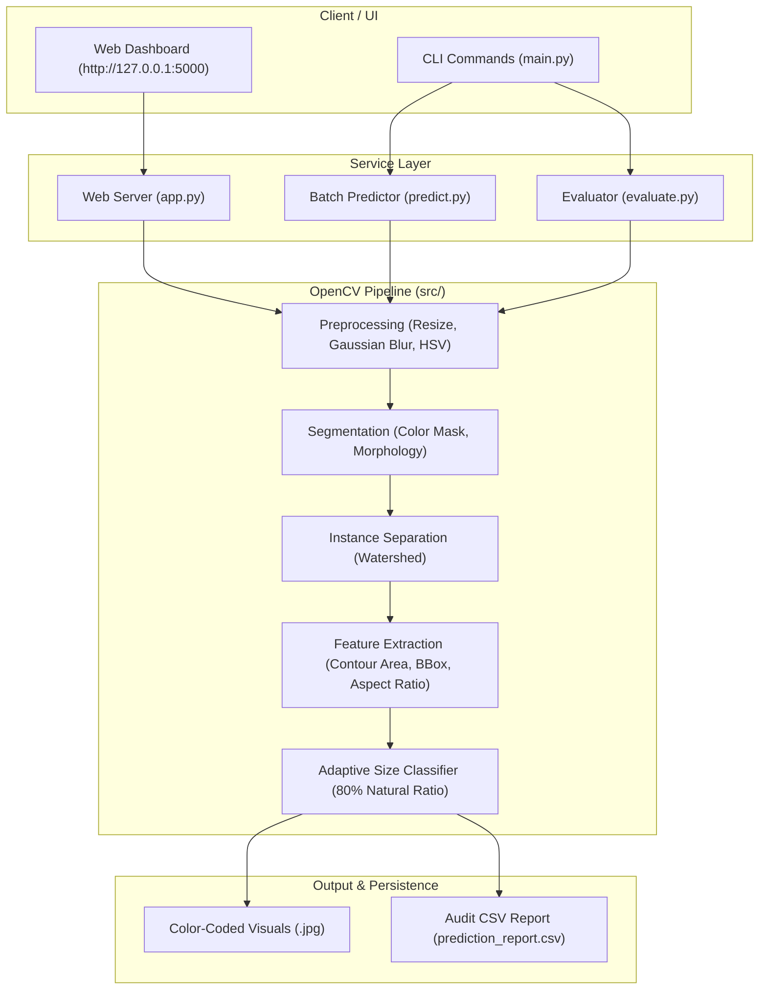

# Leafy Vegetable Detection & Size Classification System

An explainable, production-ready Computer Vision pipeline built with Python, OpenCV, and NumPy for automated individual leaf segmentation and natural size grading (**Large Leaf** vs. **Small Leaf**).

---

## 1. System Architecture



---

## 2. The 8-Stage Pipeline Flow

```text
[Input Image]
      │
      ▼
1. Preprocessing          ➔ Aspect-ratio preserving resize (256px) + 5x5 Gaussian noise filter
      │
      ▼
2. Color Conversion       ➔ BGR to HSV color space (decouples brightness from chlorophyll)
      │
      ▼
3. Segmentation           ➔ Green HSV thresholding + Decoupled morphology (3x3 open / 5x5 close)
      │
      ▼
4. Instance Separation    ➔ Euclidean Distance Transform + Marker-Controlled Watershed
      │
      ▼
5. Detection              ➔ Contour localization + Non-Maximum duplicate suppression (IoU > 0.50)
      │
      ▼
6. Feature Extraction     ➔ Contour area (Green's theorem), BBox area, Aspect Ratio, Extent
      │
      ▼
7. Size Classification    ➔ Adaptive natural contrast (80% relative ratio) vs. baseline cutoff
      │
      ▼
8. Output Generation      ➔ Annotated visuals (Lime Green / Cyan badges) + Live CSV logging
```

---

## 3. Key Features

- **Touching & Overlapping Leaf Separation**: Uses Euclidean Distance Transform and Marker-Controlled Watershed segmentation to cleanly split touching foliage along natural contact seams.
- **Natural / Adaptive Size Classification**: Automatically compares leaves in multi-leaf scenes using relative area ratios (`area / max_area < 80%` $\rightarrow$ Small Leaf, otherwise Large Leaf) while supporting baseline thresholding for solitary leaves.
- **Modern Interactive Web UI (`python main.py --ui`)**: Dark-mode dashboard with drag-and-drop image upload, instant prediction (~29ms), side-by-side preview, stats cards, and one-click CSV download.
- **High-Contrast Explainable Visuals**:
  - **Large Leaf**: Vivid Lime Green (`#32E132`) border and pill badge.
  - **Small Leaf**: Electric Cyan (`#00D7FF`) border and pill badge.
- **Unified CLI Controller (`main.py`)**: One single command-line interface to launch the Web UI, test single photos, whole folders, ZIP archives, or generate full evaluation reports.
- **Auditable Reports**: Generates structured CSV reports containing bounding box coordinates, contour areas, bbox areas, aspect ratios, and predicted classes.
- **Zero Hardcoding**: All thresholds, HSV bounds, and colors are defined in `config/config.yaml` and validated via Pydantic schemas.

---

## 4. Project Structure

```text
d:/cv_project/
├── main.py                     # Unified CLI entrypoint (--ui, --source, --evaluate)
├── app.py                      # Interactive Web Application server (http://127.0.0.1:5000)
├── predict.py                  # Direct CLI inference engine
├── classification.py           # Benchmark dataset demonstration runner
├── evaluate.py                 # Unseen test evaluation runner & contact sheet builder
├── requirements.txt            # Production dependencies (opencv-python, pydantic, pyyaml)
├── pytest.ini                  # Pytest configuration (cache-provider disabled)
├── README.md                   # System documentation & quick-start guide
├── config/
│   └── config.yaml             # Central configuration (Zero hardcoding)
├── src/
│   ├── preprocessing.py        # Aspect-ratio preserving resize & HSV conversion
│   ├── segmentation.py         # HSV masking, decoupled morphology & Watershed
│   ├── classification.py       # Geometric feature extraction & Adaptive Size Classifier
│   ├── config.py               # Pydantic schema validation & config loader
│   ├── data_loader.py          # Direct ZIP/folder in-memory image loader
│   └── logger.py               # Centralized rotating file & color console logger
├── web/                        # Modern responsive dark-theme Web UI
│   ├── index.html
│   ├── style.css
│   └── app.js
├── tests/                      # 68 Automated unit & integration tests (100% passing)
├── logs/                       # Centralized execution logs
└── outputs/                    # Visual predictions and CSV reports for custom tests
```

---

## 5. Quickstart Guide

### 1. Installation
```powershell
# Activate virtual environment
.\venv\Scripts\Activate.ps1

# Install dependencies
pip install -r requirements.txt
```

### 2. Launch Interactive Web UI
```powershell
python main.py --ui
```
Open **`http://127.0.0.1:5000`** in your browser.

### 3. Direct CLI Inference (`main.py`)

#### A. Test a Single Image
```powershell
python main.py --source "path/to/leaf.jpg"
```

#### B. Test an Entire Folder of Images
```powershell
python main.py --source "path/to/folder/"
```

#### C. Test a ZIP Archive
```powershell
python main.py --source "data/test_unseen/leafy_vegetable_unseen_test_images.zip"
```

#### D. Run Evaluation Benchmark & Generate Contact Sheet
```powershell
python main.py --evaluate
```
*Outputs contact sheet montage to `outputs/evaluation/unseen_test_contact_sheet.jpg` and review CSV report.*

### 4. Run Automated Test Suite
```powershell
pytest tests/ -v
```
*Executes all **68 automated tests** in ~0.5s covering preprocessing, empty masks, single leaves, watershed separation, boundary thresholds, and complete CSV schemas.*

---

## 6. Technical Design & Frequently Asked Questions

### Q1: Why use an Adaptive Relative Ratio (80%) instead of a fixed pixel threshold?
> **Answer**: In real-world images, leaf sizes must be interpreted in context. In multi-leaf frames, our **Adaptive Mode** computes $\text{Area} / \text{Max Area}$. If a companion leaf is under $80\%$ of the dominant leaf's area, it is categorized as **Small Leaf**; if $80\%$ or greater, it is categorized as **Large Leaf**. For solitary single-leaf images, a baseline threshold ($6,500\text{ px}$) provides the absolute cutoff.

### Q2: How are touching and overlapping leaves separated?
> **Answer**: We use **Marker-Controlled Watershed**:
> 1. Compute the **Euclidean Distance Transform** ($L_2$) on the binary green mask.
> 2. Peaks in the distance transform represent deep leaf centers (sure foreground markers).
> 3. Dilate the mask to determine sure background boundaries.
> 4. Run `cv2.watershed` to flood from markers, placing separation boundaries along the natural contact indentation seams.

### Q3: How are complex backgrounds (wood, cutting boards, soil) rejected without false positives?
> **Answer**:
> - Wood cutting boards and tables have warm brown/yellow hues ($H: 10-25$). We tuned the lower Green Hue bound to **$H \ge 28$** with a minimum saturation of $40$, cleanly excluding wood without rejecting natural leaf chlorosis.
> - Soil specks and digital noise are eliminated by a **$250\text{ px}$ minimum contour area filter** and gentle $3\times3$ morphological opening.
